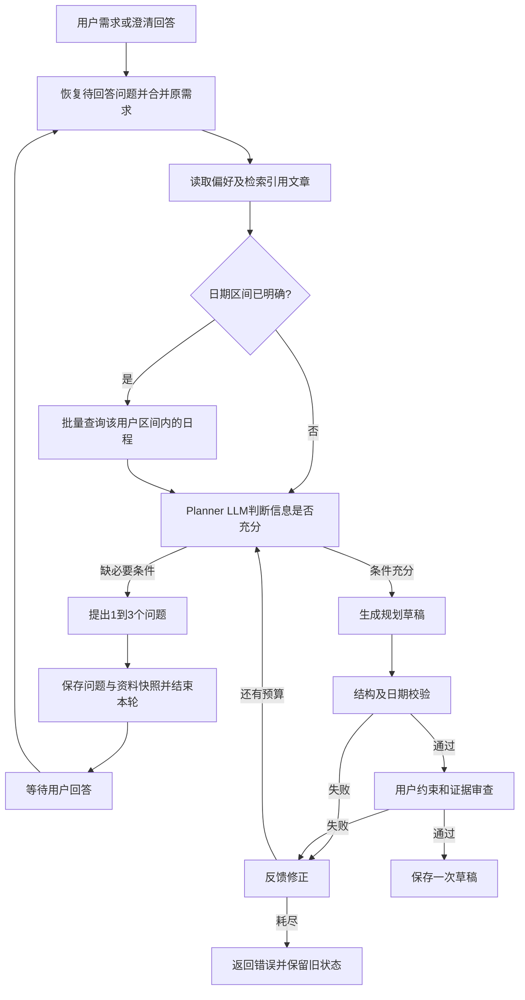

# Planning Agent Loop

规划使用“准备资料 → LLM判断是否需要澄清 → 等待用户回答或生成草稿 → 校验 → 有界自动修正 → 保存”的流程。普通请求和 SSE 使用相同的图、状态认领和提交路径。



## 模型调用前的资料准备

这里的首次 LLM 指 Planner 内部；外层 Summary/Route 按原有流程运行。Route 在已有的意图判断中可输出 `planningRange: {startDate, endDate}`，只展开用户已经明确的日期，不新增一次日期抽取模型调用。对于未提供该字段的情况，程序保守识别完整日期、今天/明天、本周/下周和未来N天等明确范围，不为“学习两周”等缺少起点的需求擅自补日期。

1. 按服务端用户 ID 查询偏好，本轮要求优先于历史偏好。失败明确标为未获得偏好。
2. 请求带 `documentIds` 时，用 `DocumentSearchService` 检索这些已就绪、归属当前用户的文章一次。片段加入 prompt；没有引用就不查 RAG。查询失败终止请求，零命中与未引用通过不同状态表示。
3. 区间已明确时，调用新增 Java MCP `queryScheduleRange({startDate, endDate})`。SQL 同时限定当前用户、未删除的待办和日期上下界，一次 JOIN 查询返回日期、标题、每日内容和完成状态；不逐日循环，也不返回区间外或其他用户的数据。跨度上限180天。结果在 Python 校验日期回显、条目范围、重复记录及必要字段。
4. 区间未知时先跳过日程查询，Planner 必须向用户询问日期，禁止直接保存猜测日期的草稿。区间查询失败也不能当作空日程继续生成。

## 澄清及跨轮恢复

模型判断缺少会实质影响方案的条件时返回：

```json
{"action":"clarify","questions":["希望从哪天开始、到哪天结束？","每天可投入多久？"]}
```

问题必须是1到3个不同的非空字符串，每项不超过240字。信息充分时直接返回完整 `Plan` JSON。非法问题进入有界反馈修正，不能被当作有效澄清或合格草稿。

`PlanNode` 将问题显示为编号列表，以 `PLAN_CLARIFICATION` 提交本轮消息，并保留 `PLAN` 阶段。`PendingTask.planning` 保存问题、已确认区间、偏好、文章 ID/片段和日程快照。仓储使用现有 `pending_payload` MEDIUMTEXT 的版本化 JSON 包装，兼容旧的纯预览文本；无需新列和 LangGraph checkpointer。凭证、模型推理和原始工具调用参数不写入快照。

用户回答作为 `MODIFY`（或回应当前问题的 `CONFIRM`）处理，合并原始需求、此前问题和本轮回答，再调用规划模型。相同文章、偏好和区间日程复用快照；用户改变日期、增加引用文章或日程快照超过10分钟时，重新准备相应资料。新规划任务不复用上一个任务的资料。临时查询/闲聊保留待回答状态，取消任务清空状态。

澄清回复不保存新草稿。修改旧草稿过程中缺条件时保留旧草稿，但在问题回答完毕前阻止同步和生图，避免把旧草稿当作新方案执行。

## 规划图与自动修正

`PlanningGraph` 使用 LangGraph 实现生成、只读工具、校验和修正节点。资料已经前置准备；模型如需再次读取，可通过原生 Tool Calling 访问缓存的 `queryPreferences` 和 `queryScheduleRange`。后者参数必须与已确认的规划区间一致，不能擅自扩大范围；不开放 RAG、单日查询、全部待办查询和写入工具。

草稿先经过 `parse_plan()`、过去日期及已确认区间边界校验，再通过一次无工具声明的模型调用，审查用户约束、知识依据和已有日程。审查只接受 `{"issues": [...]}`，问题类别为 `constraint`、`knowledge`、`schedule`，空列表表示通过。审查协议错误直接失败，不默认放行。

内容审查是模型判断，不是自然语言约束的确定性证明。同日有安排不等于冲突；只有每日内容明确提供时间时才核对时分，不能宣称完成输入不支持的检查。

每个请求最多六次模型调用（包含生成、信息充分性判断和内容审查）、两次自动修正，每轮最多四个工具调用。接近上限时关闭工具声明，为最终草稿和审查保留预算。用户回答是新请求，拥有新的请求预算。HTTP 现有总超时覆盖资料准备和内部循环。

预算耗尽返回 `50225`，审查协议错误返回 `50226`，区间资料不可用返回 `50306`；这些情况均不保存新草稿、不覆盖旧 pending。最终通过后才保存一次草稿，日历同步仍需明确的同步指令。

## SSE、部署和测试

时间线持续展示读取偏好、检索文章、查询规划区间日程、LLM处理、等待用户补充、校验和反馈修正。只展示预定义名称、问题类别/数量及摘要；真正的澄清问题作为本轮助手回复展示。历史回放沿用现有 `agent_steps`。取消会传播到模型及 MCP，请求保存前再次检查连接。

部署需同时更新 Python 和 Java MCP，旧 Java 没有 `queryScheduleRange` 时会明确报查询不可用，不会回退查询全部待办。无需变更数据库表结构。

从 `ai-service` 运行：

```powershell
.\.venv\Scripts\python.exe -m unittest discover -s tests -q
```

从 `back` 运行 `mvn test`，从 `front` 运行 `npm run test:chat` 和 `npm run build`。测试覆盖资料先于模型、问题数量校验、序列化后恢复、日期变更重查、快照过期、临时查询保留、旧草稿保护和有界自动修正。真实 MySQL 集成测试需要专用 `CHAT_TEST_MYSQL_URL`；真实模型质量及部署服务连通性仍需配置后联调。
