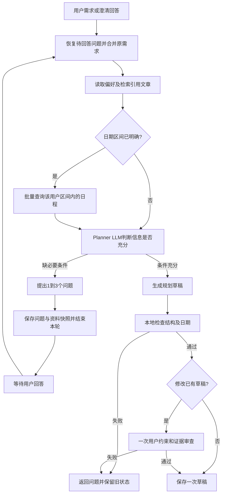

# Planning Agent Loop

规划使用“Route → 准备资料 → Planner 按需调用一轮工具 → 生成或澄清 → 本地检查 → 保存”的流程。普通规划最多三次 LLM API 调用（一次 Route、最多两次 Planner）；只有修改已有草稿时额外进行一次模型审查，总计最多四次。不再自动反复生成、审查、修正和复审。资料充分时允许直接生成，实际次数可以更少。普通请求和 SSE 使用相同的图、状态认领和提交路径。



## 模型调用前的资料准备

这里的首次 LLM 指 Planner 内部；Route 先识别意图，主图确定处理 Agent 后，规划分支跳过摘要模型，其他分支仍可在业务节点前压缩上下文。Route 在已有的意图判断中可输出 `planningRange: {startDate, endDate}`，只展开用户已经明确的日期，不新增一次日期抽取模型调用。对于未提供该字段的情况，程序保守识别完整日期、今天/明天、本周/下周和未来N天等明确范围，不为“学习两周”等缺少起点的需求擅自补日期。

1. 按服务端用户 ID 查询偏好，本轮要求优先于历史偏好。失败明确标为未获得偏好。
2. 请求带 `documentIds` 时，用 `DocumentSearchService` 检索这些已就绪、归属当前用户的文章一次。片段加入 prompt；没有引用就不查 RAG。查询失败终止请求，零命中与未引用通过不同状态表示。
3. 区间已明确时，调用新增 Java MCP `queryScheduleRange({startDate, endDate})`。SQL 同时限定当前用户、未删除的待办和日期上下界，一次 JOIN 查询返回日期、标题、每日内容和完成状态；不逐日循环，也不返回区间外或其他用户的数据。跨度上限180天。结果在 Python 校验日期回显、条目范围、重复记录及必要字段。
4. 区间未知时先跳过日程查询，Planner 必须向用户询问日期，禁止直接保存猜测日期的草稿。区间查询失败也不能当作空日程继续生成。

## 澄清及跨轮恢复

模型判断缺少会实质影响方案的条件时返回：

```json
{"action":"clarify","questions":["希望从哪天开始、到哪天结束？","每天可投入多久？"]}
```

问题必须是1到3个不同的非空字符串，每项不超过240字。信息充分时直接返回完整 `Plan` JSON。非法问题直接返回错误，不额外调用模型纠错；模型遗漏询问未确认的日期时，程序直接补问开始和结束日期。

`PlanNode` 将问题显示为编号列表，以 `PLAN_CLARIFICATION` 提交本轮消息，并保留 `PLAN` 阶段。`PendingTask.planning` 保存问题、已确认区间、偏好、文章 ID/片段和日程快照。仓储使用现有 `pending_payload` MEDIUMTEXT 的版本化 JSON 包装，兼容旧的纯预览文本；无需新列和 LangGraph checkpointer。凭证、模型推理和原始工具调用参数不写入快照。

用户回答作为 `MODIFY`（或回应当前问题的 `CONFIRM`）处理，合并原始需求、此前问题和本轮回答，再调用规划模型。相同文章、偏好和区间日程复用快照；用户改变日期、增加引用文章或日程快照超过10分钟时，重新准备相应资料。新规划任务不复用上一个任务的资料。临时查询/闲聊保留待回答状态，取消任务清空状态。

澄清回复不保存新草稿。修改旧草稿过程中缺条件时保留旧草稿，但在问题回答完毕前阻止同步和生图，避免把旧草稿当作新方案执行。

## 规划图与调用预算

`PlanningGraph` 使用 LangGraph 实现生成、只读工具、本地检查和可选审查节点。资料已经前置准备；首轮模型如需读取，可通过原生 Tool Calling 一次性请求 `queryPreferences` 和 `queryScheduleRange`，已准备的资料直接返回缓存。后者参数必须与已确认的规划区间一致，不能擅自扩大范围；不开放 RAG、单日查询、全部待办查询和写入工具。工具返回后的模型调用关闭工具声明，必须生成结果或提出澄清问题。

所有草稿都经过 `parse_plan()`、过去日期及已确认区间边界检查，属于本地代码，不调用模型。首次规划及回答首次澄清问题，到此即可保存。只有修改已有草稿时，再通过一次无工具声明的模型调用，结合旧草稿审查用户约束、知识依据和已有日程。审查只接受 `{"issues": [...]}`，问题类别为 `constraint`、`knowledge`、`schedule`，空列表表示通过。发现问题返回具体反馈并保留原草稿，不自动重新生成或再次审查。审查协议错误直接失败，不默认放行。

内容审查是模型判断，不是自然语言约束的确定性证明。同日有安排不等于冲突；只有每日内容明确提供时间时才核对时分，不能宣称完成输入不支持的检查。

每个请求最多一轮工具调用（最多四个只读调用），Planner 至多两次生成调用，重新规划至多再审查一次。没有自动纠错模型调用。用户回答是新请求，拥有新的请求预算。HTTP 整轮总超时为 300 秒，覆盖资料准备和规划流程。

模型在生成阶段继续请求工具时返回 `50225`，结构或日期无效返回 `50220`，审查协议错误返回 `50226`，重新规划审查发现问题返回 `50227`，区间资料不可用返回 `50306`；这些情况均不保存新草稿、不覆盖旧 pending。最终通过后才保存一次草稿，日历同步仍需明确的同步指令。

## SSE、部署和测试

模型 API 埋点使用 `app.model` 日志，每次真实调用输出一条开始事件及一条终态事件，状态为 `success`、`timeout`、`error` 或 `cancelled`。普通聊天、流式聊天、生图和 Embedding 共用调用 ID、厂商、模型、Agent 配置、超时配置、HTTP 状态、异常类型/错误码和耗时字段；对话中的调用还关联用户、会话、轮次和处理阶段。`complete()` 内部复用 `chat()`，不会重复计数。API 密钥、提示词、工具参数及响应正文不进入这些埋点。

耗时均为客户端观测值：`model_response_ms` 在非流式调用中表示完整 HTTP 响应到达时间，在流式调用中表示响应头到达时间；`model_first_output_ms` 仅统计流式的首个文本或工具调用片段，空角色片段和单独用量事件不计；`model_elapsed_ms` 统计本次调用的完整处理时间，流式包含消费时间。只有读到 `[DONE]` 且协议处理成功才记流式成功，半截流、协议错误和主动关闭分别按失败或取消统计。接口返回的 token 用量只提取合法非负整数；缺失时不估算，也不为了用量另发请求。

单轮流转日志汇总模型 API 次数、成功/超时/失败/取消数量和累计耗时；结构化字段 `flow_details.模型API调用` 保留逐次明细，`flow_details.模型API统计` 保留汇总。累计耗时是各调用耗时之和，并行调用时不等于整轮墙钟时间。独立的 Embedding API 也计入 API 汇总，不计入 Route/Planner 的 LLM 调用预算。

`ROUTE_REQUEST_TIMEOUT` 默认及当前 `.env` 均为 60 秒；整轮 `CHAT_STREAM_TIMEOUT_SECONDS` 为 300 秒，两者分别生效，服务重载后应用配置。

前端会话页和首页聊天侧栏共用 `PlanningFollowUp`：待回答时展示 1～3 个实际问题及日期、引用数量，同时隐藏普通输入框并暂停语音录入。表单回答按编号合并为普通聊天消息续答，也可取消本次规划。草稿就绪或取消规划后恢复普通输入框。草稿就绪后才显示同步、生图按钮；旧草稿仍有待回答问题时继续展示问题。发送中禁用操作。

普通响应及 SSE `result` 增加 `planning` 摘要，包含 `status`（`none` / `awaiting_answers` / `draft_ready`）、`questions`、`questionSetId`、`dateRange` 和 `referenceCount`。`GET /chat/state?sessionId=...` 使用相同摘要恢复刷新、历史会话及撤回后的交互状态，不新建会话，也不返回资料快照。`questionSetId` 标识一组问题，同组问题重试保留本地未提交回答；会话切换清空回答。前端忽略切换前和新 SSE 结果之前发起的过时状态请求，读取失败时关闭草稿操作并提供重试。

时间线持续展示读取偏好、检索文章、查询规划区间日程、LLM处理、等待用户补充、本地检查和重新规划时的一次审查。只展示预定义名称、问题类别/数量及摘要；真正的澄清问题作为本轮助手回复展示。历史回放沿用现有 `agent_steps`。取消会传播到模型及 MCP，请求保存前再次检查连接。

部署需同时更新前端、Python 和 Java MCP，旧 Java 没有 `queryScheduleRange` 时会明确报查询不可用，不会回退查询全部待办。前端恢复状态依赖新版 Python 的 `/chat/state`。无需变更数据库表结构。

从 `ai-service` 运行：

```powershell
.\.venv\Scripts\python.exe -m unittest discover -s tests -q
```

从 `back` 运行 `mvn test`，从 `front` 运行 `npm run test:chat` 和 `npm run build`。测试覆盖三次/四次调用上限、规划跳过摘要、首次澄清不审查、单轮工具及缓存、审查失败保留旧草稿、非法输出停止、取消请求、跨轮资料恢复和保存一次。真实 MySQL 集成测试需要专用 `CHAT_TEST_MYSQL_URL`；真实模型质量及部署服务连通性仍需配置后联调。
